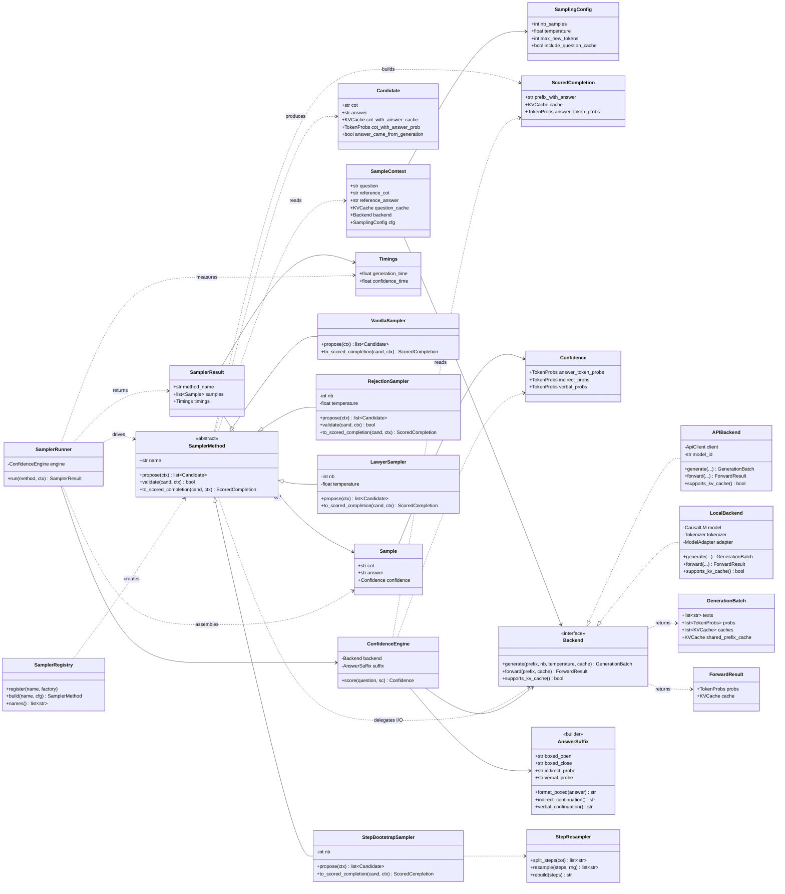
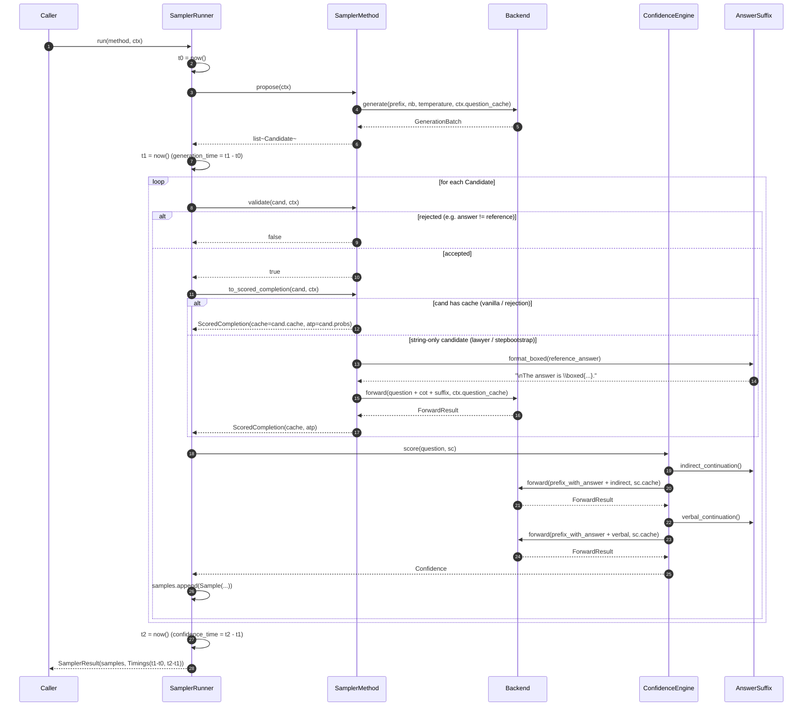

# Confidence Sampler UML

UML diagrams for the design patterns proposed for `confidence_pseudocode.py`.

## Class diagram

## Sequence diagram — one sampler invocation

## Pattern map

| Pattern | Where it lives in the diagram |
|---|---|
| Template Method | `SamplerMethod` defines the shape; `SamplerRunner.run` is the invariant skeleton; subclasses fill `propose` / `validate` / `to_scored_completion` |
| Strategy + Registry | The four `*Sampler` classes are interchangeable; `SamplerRegistry` is the lookup |
| Adapter | `Backend` interface with `APIBackend` / `LocalBackend` realizations hides `use_api` |
| Unified probe scoring | `ConfidenceEngine.score` consumes a `ScoredCompletion` regardless of how it was produced |
| Builder | `AnswerSuffix` is the single source of truth for `\boxed{...}` and the indirect/verbal probe strings |
| Filter pipeline | `validate(cand, ctx)` on `SamplerMethod`; rejection and lawyer use it, vanilla and stepbootstrap default it to `true` |
| Parameter Object | `SampleContext` and `SamplingConfig` replace the long argument lists |
| Value objects / DTOs | `Candidate`, `ScoredCompletion`, `Confidence`, `Sample`, `Timings`, `SamplerResult` replace the raw dicts in the pseudocode |

The structural insight the diagram makes visible: every arrow that used to be a `use_api` branch in the pseudocode is now an arrow into `Backend`, and every arrow that used to be `confidence_from_answerprob` vs `confidence_from_cot_string` is now an arrow into `ConfidenceEngine.score` via a `ScoredCompletion`. Those are the two seams that collapse the duplication.
